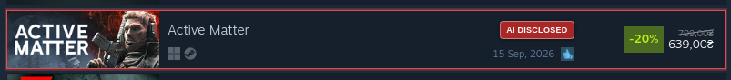
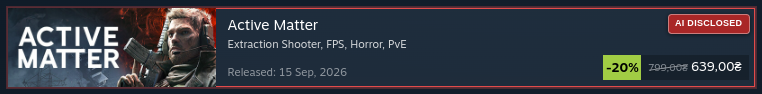
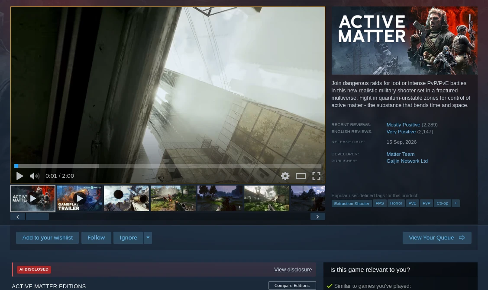
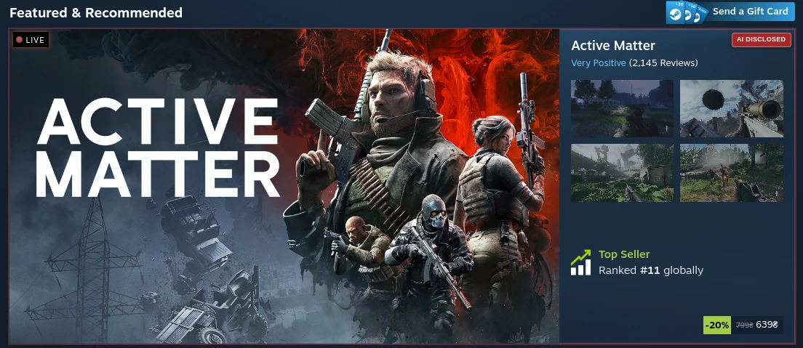

# Steam Notify AI

A small SFP customization for Steam. It highlights Store games whose Steam product page contains the developer's explicit **AI Generated Content Disclosure**. The Store script does **not** hide games, infer undisclosed AI use, report games, or change account data.

## What’s included

- `webkit.js` — adds a badge/outline to explicitly disclosed Store cards and a disclosure banner on the product page. The script includes its own injected styles; a separate Store CSS file is not needed.
- `tests/` — dependency-free Node.js tests.
- [SFP setup tutorial](docs/SETUP.md) — step-by-step Linux setup, adding the JavaScript file, verification, and removal.

For Windows or macOS SFP installation, follow the [official SFP setup guide](https://github.com/PhantomGamers/SFP#instructions) linked in Quick setup; this step-by-step tutorial covers Linux.

## Screenshots

Examples of the disclosure badge and product-page banner in Steam:

**Steam search listing**



**Featured page listing**



**Game details page**



**Featured page carousel**



## Behavior and limits

- Matches Steam's explicit developer-authored disclosure heading. It does not determine whether a game used AI when the developer did not disclose it.
- Does not use community reports or third-party disclosure databases.
- Checks Store cards with same-origin Steam Store requests; caches results for 7 days, allows at most two concurrent lookups, spaces requests by 800 ms, and pauses after Steam responds with HTTP 403/429.
- Defers cards beyond the queue limit rather than dropping them.
- Handles lazy-loaded cards, multiple Steam descriptor blocks, release/review alignment (including rows without a review icon), and the product-page purchase section.

## Quick setup

1. Install and run [SFP](https://github.com/PhantomGamers/SFP) using its [official setup guide](https://github.com/PhantomGamers/SFP#instructions) and [official releases](https://github.com/PhantomGamers/SFP/releases); keep SFP running while Steam is open.
2. Put `webkit.js` in Steam's `steamui` folder using SFP's **Open File** controls (details and backup advice are in [the tutorial](docs/SETUP.md)).
3. Enable SFP's JavaScript injection. JavaScript injection is disabled by default; enable it only after reviewing the script.
4. Start/restart Steam through SFP and confirm `webkit.js` appears in SFP's injection log.

## Tests

Requires Node.js with the built-in test runner; there are no npm dependencies.

```bash
node --check webkit.js
node --test tests/*.test.cjs
```

## Credits and license

The Store-listing disclosure-highlighting idea is adapted from **[Steam Hide AI](https://github.com/Suvitruf/steam-hide-ai)**, a Tampermonkey/Violentmonkey userscript by **Suvitruf (Andrei Apanasik)**. This repository is a separate SFP-focused implementation: it highlights disclosed games instead of hiding them and does not include the upstream community reporting or filtering features. This project is released under the **MIT License**; [`LICENSE`](LICENSE) retains the upstream copyright notice and adds **Ihor Mohylnyi** for this project's contributions.

SFP is maintained by [PhantomGamers](https://github.com/PhantomGamers/SFP). Steam and Valve are trademarks of Valve Corporation. This project is unofficial and is not affiliated with or endorsed by Valve, SFP, or the upstream userscript author.

## AI assistance disclosure

Generative AI assisted the development and maintenance of this repository: code adaptation and cleanup, debugging, test creation, and documentation were done with Hermes Agent using OpenAI GPT-6 Luna. The code, tests, and README were also reviewed by a human maintainer. The runtime itself does **not** call an AI model or AI service. Its result is based only on Steam's explicit developer disclosure text; the badge is not an AI classification or a claim about undisclosed AI use.
